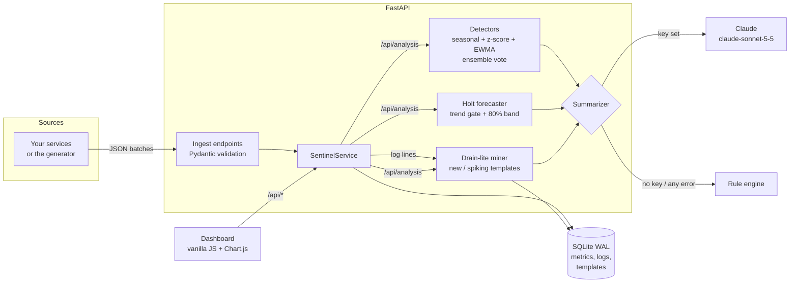

# Log Sentinel

Monitoring that warns you **before** a service falls over. Log Sentinel ingests metrics and log lines over a small JSON API, flags anomalies with an ensemble of statistical detectors, mines log lines into templates to catch new or spiking error patterns, and forecasts **when** a slowly degrading metric will cross its failure threshold ("DB connection pool exhausted in ~2h 25m", with an 80% band and a confidence level). An incident summary ties it all together: Claude writes it when an API key is configured, and a deterministic rule engine writes it when there is none. The app works fully offline and seeds itself with 7 days of synthetic telemetry that contain real-looking incidents.

## Why

Threshold alerts fire when the damage is already done, and naive anomaly detection pages people for every Monday-morning traffic ramp. On-call engineers need three things a plain dashboard doesn't give them:

1. **Lead time.** A memory leak or a connection leak is visible hours before the OOM kill. A forecast with an honest uncertainty band turns that into "fix it after lunch" instead of "fix it at 3 a.m.".
2. **Few false alarms.** Detectors have to understand daily seasonality and agree with each other before anyone gets paged.
3. **Context.** "Latency is high" is half an answer. "Latency is high, and a new `Timeout calling payment provider` log pattern started at the same minute" is a lead.

Every detector here is scored against injected incidents with known start times, so the numbers below are measured, not claimed.

## Features

**Ingest**
- `POST /api/ingest/metrics` and `POST /api/ingest/logs` take batches of up to 5,000 items. Pydantic validates them: metric names follow `^[a-z][a-z0-9_.]{0,63}$`, values must be finite, log levels are normalised (`warning` becomes `WARN`). Invalid payloads get a structured `422 validation_error`.
- SQLite in WAL mode behind one lock; the data model is just metric points, log lines and log templates.

**Anomaly detection (per metric)**
- **Seasonal baseline:** the median of the same 5-minute slot on previous days, with a MAD-based robust spread. This is what stops the morning ramp from paging anyone.
- **Rolling z-score** and **EWMA** residual detectors for short-term level shifts.
- An **ensemble rule** decides: at least two detectors must agree beyond the z threshold (default 4), or one detector must be extreme (at least 2x the threshold). An alert also needs at least 2 consecutive anomalous points unless the peak reaches 3x the threshold, so single-sample blips are ignored.

**Log pattern mining (Drain-lite)**
- Masks UUIDs, IPs, hex ids and numbers, then groups lines into templates by token-wise similarity within a length bucket (`Timeout calling payment provider after <NUM> ms`).
- **New template** alerts fire for a WARN/ERROR pattern never seen before. **Spike** alerts fire when the last hour's count is improbable under a Poisson model at the template's busy-hour rate (p < 1e-6).
- Click a template in the dashboard to see its most recent raw lines.

**Failure prediction**
- **Holt's linear trend** (double exponential smoothing) runs on the de-seasonalised last 6 hours of every metric that has a failure threshold.
- Before forecasting, a **trend gate** (OLS slope t-statistic >= 4 and R^2 >= 0.3) rejects noise, so flat metrics don't produce imaginary ETAs.
- The output is a time to threshold with an **80% band** (from residual spread, widened with the horizon) and a **confidence** score (0.55 x R^2 + 0.45 x band tightness). Low-confidence forecasts are shown with `info` severity and never page.

**Incident summary**
- `rules` (always available): correlates predictions, open anomalies and log patterns from the last 6 hours, ranks by urgency and attaches each metric's runbook as next actions.
- `claude` (optional, `ANTHROPIC_API_KEY`): sends the same compact JSON snapshot to `claude-sonnet-5-5` and asks for an on-call write-up as JSON. Any failure (missing key, network error, refusal, truncated or malformed output) falls back to the rules, and the response records `fallback_reason`.

**Dashboard** (vanilla JS + Chart.js, no build step)
- Health score, open alerts, predicted failures, errors in the last hour and template count as KPI tiles.
- One prediction card per at-risk metric: ETA, band, confidence, a progress bar toward the threshold and the runbook hint.
- One chart per metric: value, seasonal expectation, anomaly markers, the forecast line with its 80% band, and the threshold. Ranges are 12h, 48h and 7d.
- Alerts feed (open or all), incident summary panel, templates table with expandable recent lines, and a "Regenerate demo data" button.
- Dark and light themes (`?theme=light|dark`), keyboard refresh (R), 60 s auto-refresh, GSAP motion that respects `prefers-reduced-motion`, and a phone layout.

**Production touches:** request-id middleware with JSON structured logs, consistent error envelopes, `/health` (returns 503 when degraded), env-based config, a multi-stage non-root Dockerfile with a HEALTHCHECK, hardened compose (read-only root fs, tmpfs, no-new-privileges), and GitHub Actions CI (ruff, tests on Python 3.11 to 3.13 with a coverage gate, quick benchmark artifact, Docker build plus a smoke test).

## Architecture



## Results

All numbers come from `python -m logsentinel bench` (full report: [examples/benchmark.md](examples/benchmark.md), raw data: [examples/benchmark.json](examples/benchmark.json)). Measured on 2026-11-18 on Windows with Python 3.12.3; the benchmark takes about 26 s.

Setup: 10 synthetic 7-day datasets (seeds 1 to 10) at 5-minute resolution. Each has 5 injected incidents (3 sudden: a payment provider slowdown, a bad deploy throwing exceptions, a runaway batch job; 2 slow-burn: a memory leak and a DB connection leak). The datasets also contain harmless one-sample blips and a benign deploy that introduces a new INFO log pattern. Scoring is event level: an alert counts as a true positive when it lands inside an incident window (plus a 30-minute grace period); anything else is a false positive.

### Detection quality (all 10 seeds pooled)

| Detector | Alerts | False positives | Precision | Recall | Median time to detect |
|---|---:|---:|---:|---:|---:|
| Metric anomalies (ensemble) | 76 | 2 | 0.97 | 1.00 (50/50) | 0 min |
| Trend forecasts (Holt, ETA <= 24h; slow-burn incidents) | 27 | 1 | 0.96 | 1.00 (20/20) | 180 min |
| Log patterns (new / spiking) | 132 | 10 | 0.92 | 1.00 (50/50) | 0 min |
| Combined | 235 | 13 | 0.94 | 1.00 (50/50) | 0 min |

Most log-pattern false positives come from the benign deploy's new log line, which is counted as a false positive on purpose. The trend detector's 180-minute median is how long a slow leak takes to become statistically distinguishable from noise. It still fires hours before the threshold is crossed (see the next table).

### Time-to-threshold forecasts (backtest)

For each slow-burn incident the forecaster saw only past data and was run 3, 2, 1 and 0 hours before the end of the data. Its ETA was then compared with the moment the metric really crossed its threshold in the hidden future.

| Measure | Value |
|---|---:|
| Forecasts made | 79 / 80 |
| True crossing inside the 80% band | 78 / 80 (98%) |
| Mean absolute ETA error | 44.0 min |
| Median absolute ETA error | 30 min |
| Median true time to threshold | 202.5 min |
| MAE when forecast 3h / 2h / 1h / 0h before end | 62.5 / 44.8 / 38.2 / 30.2 min |

The error shrinks as the failure gets closer, which is what an on-call engineer needs. The band covering 98% of cases while nominally 80% means the bands are conservative (slightly too wide) rather than overconfident.

### Throughput (single process, SQLite in memory)

Dataset: 10,085 metric points and 9,037 log lines (17 templates mined).

| Path | Throughput |
|---|---:|
| Service layer, metric points | 369,687 points/s |
| Service layer, log lines incl. template mining | 95,841 lines/s |
| HTTP API, metric points (JSON + validation) | 85,615 points/s |
| HTTP API, log lines | 39,075 lines/s |
| Full analysis (5 metrics x 7 days + logs) | 323.5 ms |

## Quickstart

```bash
python -m venv .venv && . .venv/bin/activate      # Windows: .venv\Scripts\activate
pip install -r requirements.txt
python -m logsentinel serve                         # http://127.0.0.1:8016
```

On first start the database is empty, so 7 days of synthetic telemetry ending "now" are generated (under a second). Open the dashboard, check the predicted failures and press **Summarize now**. To enable Claude summaries, copy `.env.example` to `.env` and set `ANTHROPIC_API_KEY`.

Other commands:

```bash
python -m logsentinel reset --seed 7       # regenerate the demo data
python -m logsentinel eval                 # precision/recall on one reproducible dataset (Markdown or --json)
python -m logsentinel bench                # full benchmark -> examples/benchmark.{md,json}
python -m logsentinel bench --quick        # 3 seeds, smaller throughput run (used in CI)
```

Send your own data:

```bash
curl -X POST localhost:8016/api/ingest/metrics -H "content-type: application/json" \
  -d '{"points":[{"ts":1794996000,"metric":"memory_pct","value":71.5,"host":"web-1"}]}'
curl -X POST localhost:8016/api/ingest/logs -H "content-type: application/json" \
  -d '{"lines":[{"ts":1794996000,"level":"error","message":"Timeout calling payment provider after 3021 ms"}]}'
```

The five built-in metrics (`cpu_pct`, `memory_pct`, `latency_p95_ms`, `error_rate_pct`, `db_connections`) have failure thresholds and runbooks in `logsentinel/config.py`. Any other metric name is accepted and gets anomaly detection in both directions, but no forecast.

### Docker

```bash
docker compose up --build                  # http://localhost:8016, data in the "sentinel-data" volume
```

## Configuration

All settings are environment variables (see [.env.example](.env.example)); everything is optional.

| Variable | Default | Meaning |
|---|---|---|
| `ANTHROPIC_API_KEY` | empty | Enables Claude summaries |
| `CLAUDE_MODEL` | `claude-sonnet-5-5` | Model for summaries |
| `SENTINEL_LLM` | `auto` | `auto` (Claude if a key is set), `rules` or `claude` |
| `SENTINEL_DB` | `logsentinel.db` | SQLite file (`:memory:` works too) |
| `SENTINEL_SEED_DEMO` / `SENTINEL_DEMO_DAYS` | `true` / `7` | Seed synthetic data into an empty database |
| `SENTINEL_Z_THRESHOLD` | `4` | Anomaly threshold for the ensemble |
| `SENTINEL_FORECAST_WINDOW_HOURS` / `_HORIZON_HOURS` | `6` / `48` | Forecast fit window and maximum ETA |
| `SENTINEL_LOG_LEVEL` / `SENTINEL_LOG_JSON` | `INFO` / `true` | Structured logging on stdout |

## REST API

Interactive docs at `/docs`.

| Method | Path | Purpose |
|---|---|---|
| GET | `/health` | Liveness, DB status, row counts, summary mode (503 if degraded) |
| GET | `/api/config` | Metric catalogue, thresholds, version, LLM mode |
| POST | `/api/ingest/metrics` | `{"points":[{ts, metric, value, host?}]}`, 1 to 5,000 per batch, returns 202 |
| POST | `/api/ingest/logs` | `{"lines":[{ts, message, level?, service?}]}`, 1 to 5,000 per batch, returns 202 |
| GET | `/api/analysis` | Full snapshot: KPIs, predictions, alerts, per-metric status |
| GET | `/api/metrics` | Per-metric overview (latest value, status, threshold) |
| GET | `/api/series?metric=&hours=` | Values, seasonal expectation, anomalies and forecast for one metric |
| GET | `/api/templates?limit=&sort=recent\|count` | Mined log templates with counts, baseline rate and flags |
| GET | `/api/logs?template_id=&level=&limit=` | Recent raw log lines |
| POST | `/api/summary` | Incident summary (Claude or rules; never fails because of the LLM) |
| POST | `/api/demo/reset` | `{"seed": 42}`: regenerate 7 days of synthetic data ending now |

Errors share one envelope: `{"error": "validation_error" | "not_found" | "internal_error", "detail": ...}`. Every response carries an `x-request-id` header (taken from the request if present) that also appears in the structured logs.

## Design decisions

- **Statistics before machine learning.** Seasonal baselines, z-scores, EWMA and Holt are explainable ("3.9 sigma above the usual Tuesday 09:00"), need no training data, and run in milliseconds. The benchmark shows they are sufficient for this problem, and the LLM is used only where language helps: the summary.
- **Ensemble voting to cut pages.** Each single detector has its own failure mode: z-scores react to seasonal ramps, and EWMA lags after level shifts. Requiring agreement (or one extreme score) plus a minimum duration removed most false positives without losing recall.
- **Forecast only what is trending.** The OLS t-stat and R^2 gate sits in front of Holt because Holt will happily extrapolate noise. A forecast without a band is a guess, so every ETA ships with one, plus a confidence score that decides whether it may page.
- **A 3-day warmup for trends.** With only 2 days of history the seasonal profile is too thin and ordinary morning ramps looked like leaks. Trend alerts therefore start after 3 days of data; anomaly and log detection start earlier.
- **Poisson spikes at the busy-hour rate.** Comparing the last hour against the template's typical busy hour (not its average) stops daily traffic peaks from looking like spikes.
- **The LLM is optional and fenced.** Claude gets a compact, pre-computed snapshot (no raw logs) and has to answer in JSON that is validated; on any failure the rule engine answers. The app never needs the network to be useful.
- **Honest evaluation.** Incidents are injected with known windows, scored at event level with an explicit grace period, and the benign deploy is deliberately counted against the log miner.

## Tests

```bash
python -m unittest -v                      # 45 tests, offline, about 10 s
python -m coverage run -m unittest && python -m coverage report
ruff check .
```

The suite covers the detectors (seasonal ramps don't alert, spikes do), the forecaster (ETA accuracy on synthetic trends, gate rejection of noise, band behaviour), the log miner (masking, template merging, new and spike rules), storage and the generator, service-level evaluation against injected incidents, both summarizers (Claude through a fake client, including refusal, malformed JSON and API errors falling back to rules), the HTTP API (validation errors, 404s, ingest and analysis round trips), config parsing and the JSON log formatter. Line coverage is about 95%.

## Project structure

```
logsentinel/
  config.py         settings from env, metric catalogue (thresholds, runbooks)
  storage.py        SQLite schema and queries (WAL, one lock)
  generator.py      synthetic telemetry with injected incidents and benign noise
  detectors.py      seasonal baseline, rolling z, EWMA, ensemble events
  logmine.py        Drain-lite masking and template mining, new/spike rules
  forecast.py       trend gate + Holt time-to-threshold with 80% band and confidence
  service.py        SentinelService: ingest, analysis snapshot, health
  evaluation.py     event-level precision/recall and forecast backtest
  summary.py        rule-based and Claude summarizers with fallback
  logging_setup.py  JSON log formatter
  web/              FastAPI app and static dashboard (index.html, app.js, style.css)
benchmarks/bench.py multi-seed quality + throughput benchmark
tests/              unittest suite
examples/           benchmark.md / benchmark.json
```

## Limitations

- Evaluated on synthetic, single-service data. Real telemetry has messier seasonality (weekly cycles, holidays) and needs per-metric tuning.
- "Time to detect" is measured from the first anomalous point. In practice an alert also waits for the 2-point minimum (one more 5-minute sample).
- The trend forecaster needs 3 days of history before it raises alerts.
- SQLite with one process is fine for one service and a few hundred thousand points per second of ingest, but it is not a multi-tenant time-series store. There is no retention or downsampling yet.
- The ingest API has no authentication or rate limiting; put it behind a gateway before exposing it.
- Chart.js and GSAP load from cdnjs without Subresource Integrity hashes.

## Tech stack

Python 3.11+, FastAPI, Pydantic v2, Uvicorn, SQLite (stdlib `sqlite3`), Anthropic Python SDK, vanilla JavaScript, Chart.js 4, GSAP 3, Docker, GitHub Actions, ruff, unittest + coverage.
